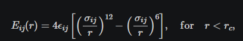

### Tutoiral 1  fluids

Genearlly lammps is broken into 5 sections
1. Initization Global parameters for the simulation are defined, such as units, boundary conditions (e.g., periodic or non-periodic), and atom types (e.g., uncharged point particles or extended spheres with a radius and angular velocities).
2. System definitions. here we define the size of the imulation and the number and type of atoms present. Of note here '''create_box 2 simbox''' defines the number of types of atoms that can exisit within the dimensions of simbox. In LAMMPS, every atom is assigned an atom type property. This property selects which force field parameters (here, the Lennard-Jones parameters, and ) are applied to each pair of atoms via the pair_coeff command (see below).
3. Settings here we define the properties of our atoms. For this example we define it with mass and cut off distances using th eflow formula
 
The fourth line, pair_coeff 1 1 1.0 1.0, specifies the Lennard-Jones coefficients for interactions between pairs of atoms that both have atom type 1: the energy parameter and the distance parameter 1-1=1.0. Similarly, the last line sets the Lennard-Jones coefficients for interactions between atoms of type 2, , and .
4. Monitoring tells lammps when to write human readable outputs for programs or yourself to read. Here thermo tells lammps to print the termodynamic info every n steps. The thermo_style custom command defines the specific outputs, which in this case are the step number (step), total energy (etotal), and pressure (press).
5. Run, This can be many things including minimisation and zero point energy. for zero '''run 0 post no''' for minimise '''minimize 1.0e-6 1.0e-6 1000 10000'''

### Part B MD
Now lets work on something more complex
after the first run we can immedietly run the next. 
Here we can do a MD simulation now.
The fix nve command updates the positions and velocities of the atoms in the group all at every step. 
We can also add more detail on what we should output for data points. 